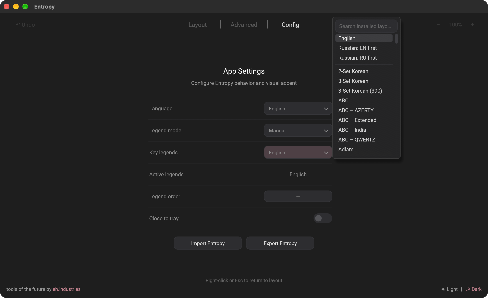
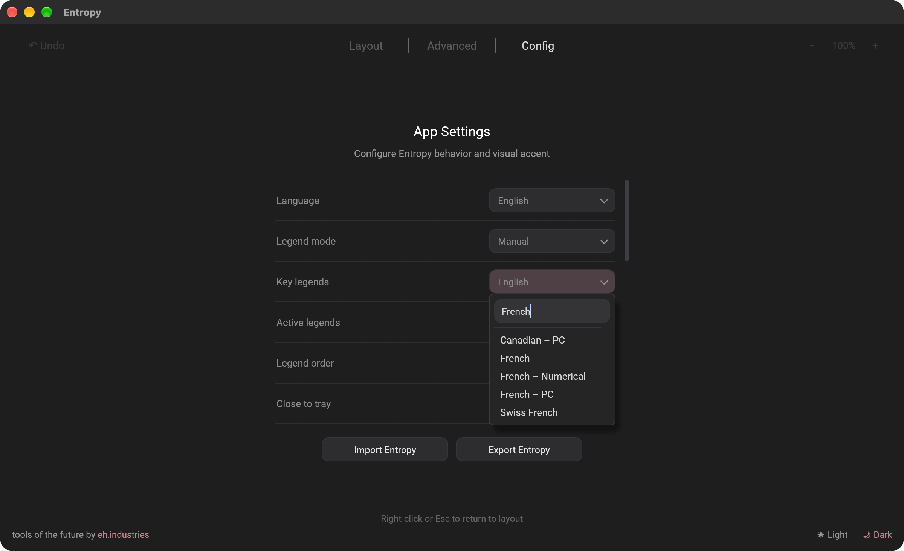
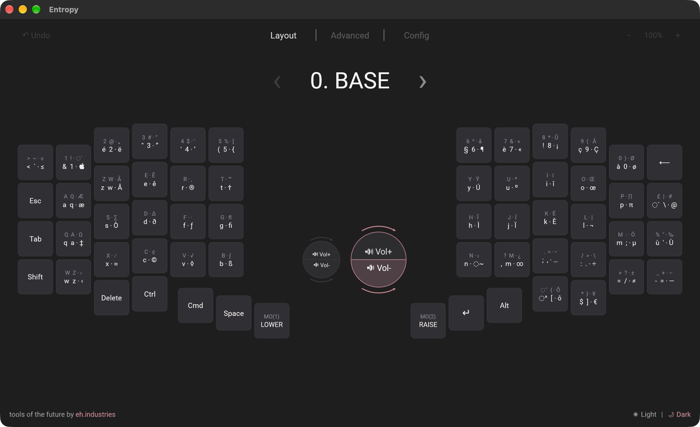
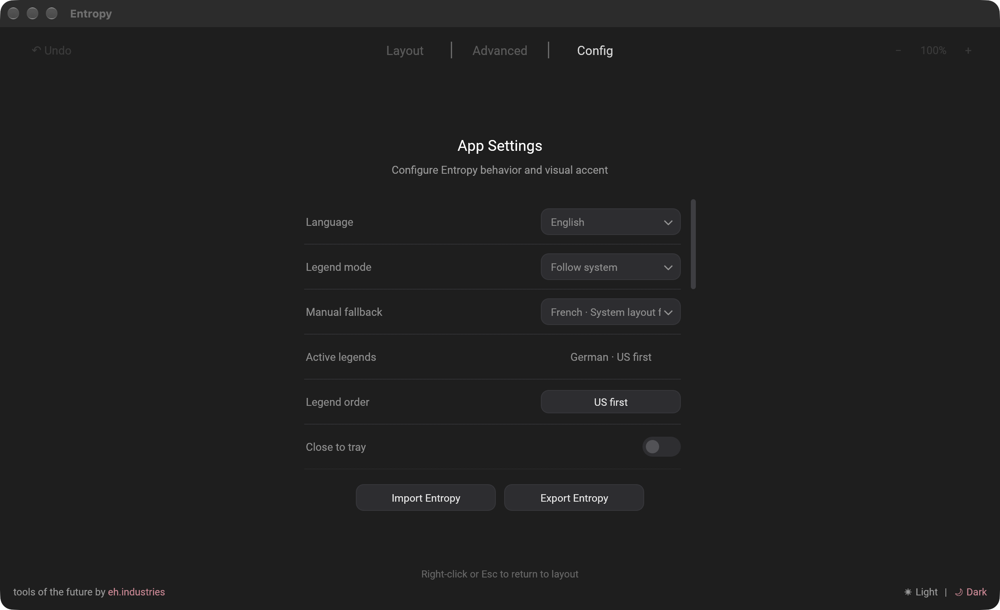
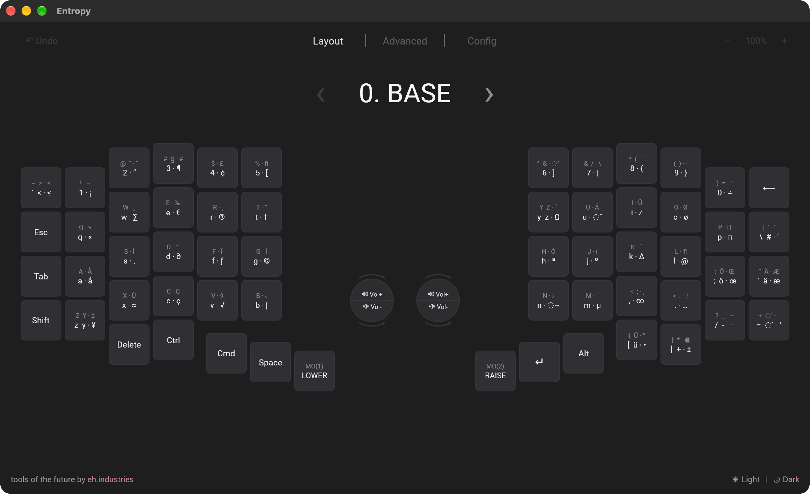
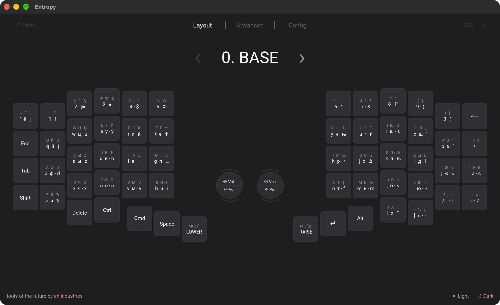
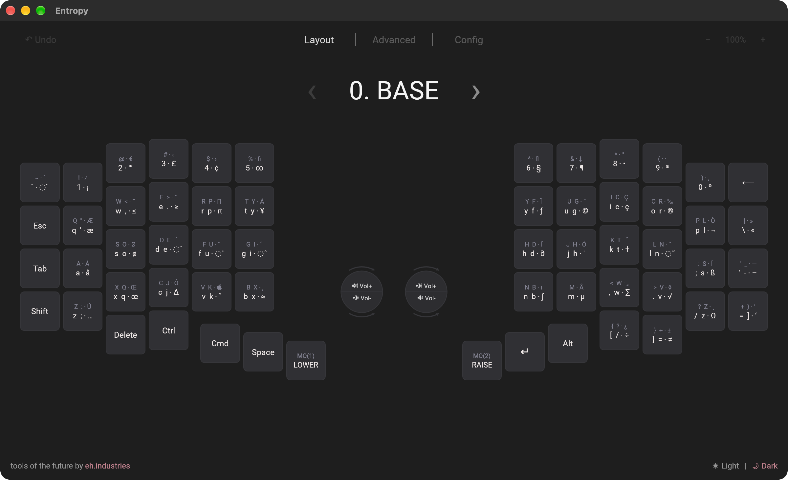
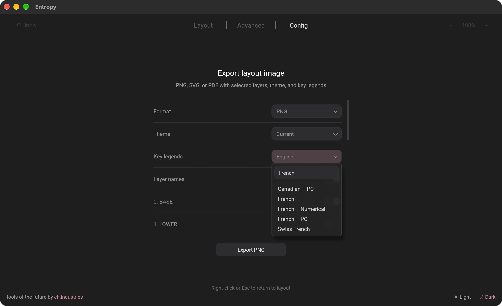

# Keyboard legends from system layouts

Entropy can display legends from system keyboard mappings, with either a fixed manual choice or automatic following of the active OS layout. These controls change display labels; the keyboard’s programmed assignments remain the same.

## Walkthrough

Screenshots were captured from a local macOS build with Phenom connected over USB.

### 1. Browse the system catalogue

Open Config → App Settings, leave Legend mode on Manual, and open Key legends. The list includes keyboard layouts supplied by your operating system. Scroll to browse beyond the original English and Russian presets.

### 2. Search and select a layout

Type a name into the search field. This example finds French, French – Numerical, French – PC, Swiss French, and Canadian – PC. Select the exact variant you want.

### 3. Use a fixed display layout

French now supplies the key legends, including its A/Q and W/Z positions, punctuation, and Option characters. Manual selection stays fixed when you switch your OS input source. Legend order chooses whether US or system characters appear first.

### 4. Follow the active system layout

Choose Follow system in App Settings, then switch the input source using your operating system. Active legends shows the detected layout: German in this capture. Manual fallback remains French and is used when native mapping data is unavailable or stale.

## Examples of automatic detection

### German detected automatically

The same Phenom key assignments now display German legends, including the Y/Z positions and umlauts. No additional hardcoded language profile is needed.

### Russian – PC detected automatically

Switching macOS to Russian – PC refreshes the legends to Cyrillic. Russian – PC is a distinct OS layout; it is not Russian Typewriter.

### Dvorak detected automatically

Switching to Dvorak changes the legends again, including the punctuation at the Q/W/E positions. This demonstrates detection of a layout outside the original English/Russian presets.

## 5. Choose export legends separately

Open Layout → Export image → Key legends. The same searchable catalogue is available for PNG, SVG, and PDF exports. This setting is independent of the main view and Follow system; choose the layout you want to share.

## Which layouts are available?

The catalogue comes from the OS and is not limited to a built-in language list. A layout must expose readable key mapping data. Input methods that compose text may not provide a direct character for every key.

| Platform | Source of layouts and automatic detection |
| --- | --- |
| macOS | Installed keyboard layouts with Unicode mapping data. Follow system reads the active input source or its backing keyboard layout. |
| Windows | Keyboard layouts loaded into the user session. Add or enable the desired layout in Windows first; following uses the foreground application’s layout. |
| Linux | Layouts and variants from the system XKB data. Following reads the active X11 server map, supported IBus engine, or KDE keyboard configuration, including its model. Availability on Wayland depends on the desktop/input backend. |

For Russian Typewriter, select that exact layout when your OS provides it. On Linux, search for `typewriter` or `xkb:ru:typewriter`. macOS shows its own installed layout names; the Russian – PC screenshot above does not demonstrate Typewriter.

Manual selection reads a mapping without activating that OS input source. If automatic detection cannot read a current mapping, Entropy uses the saved manual fallback and displays its detection status. Image exports keep their own selection.

Validation for these captures: Phenom USB, Vial protocol 6, runtime firmware 4.0.5. Manual French and live German, Russian – PC, Dvorak, and US switching were checked locally. The machine exposed 264 readable layout descriptors; this is not a claim that every layout was exercised. Windows GUI and live KDE/IBus sessions were not tested on this macOS machine.
